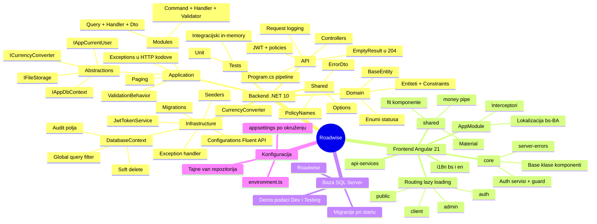
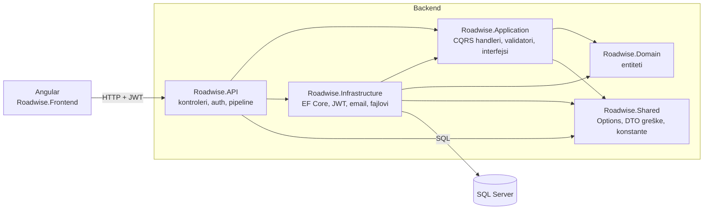
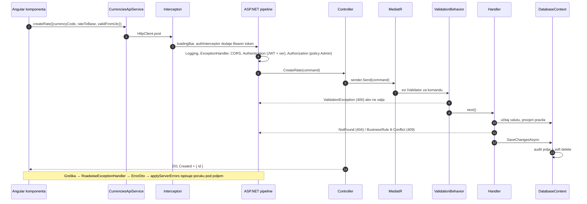
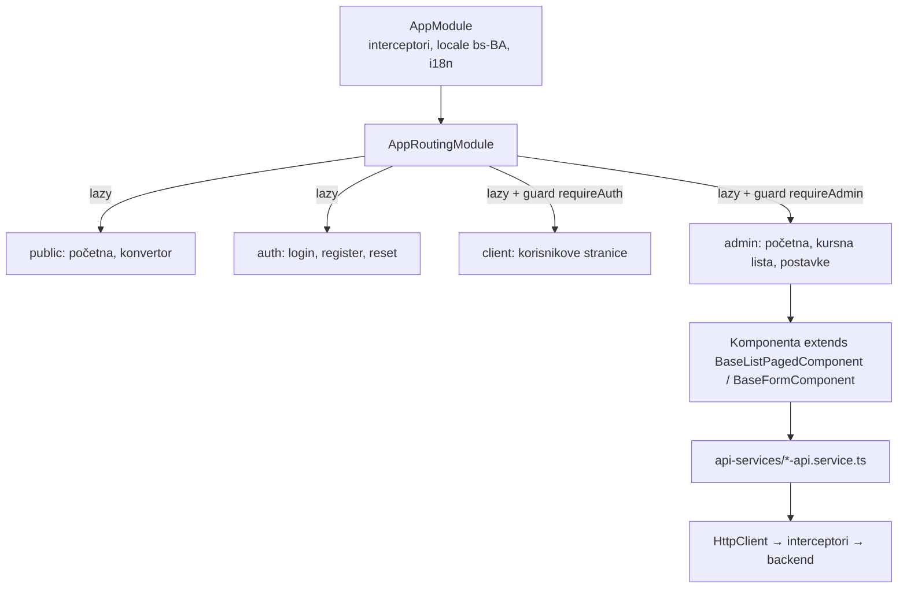
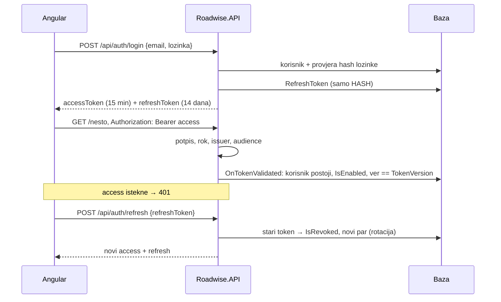
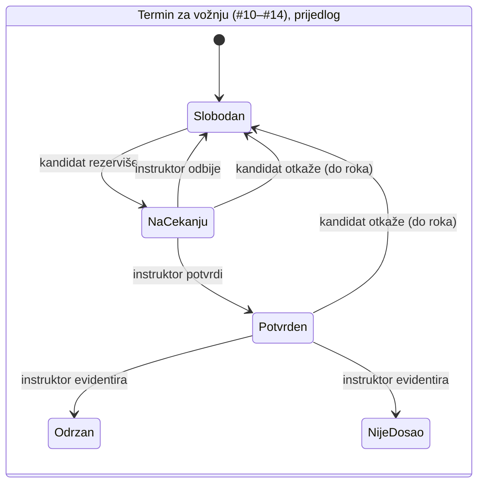
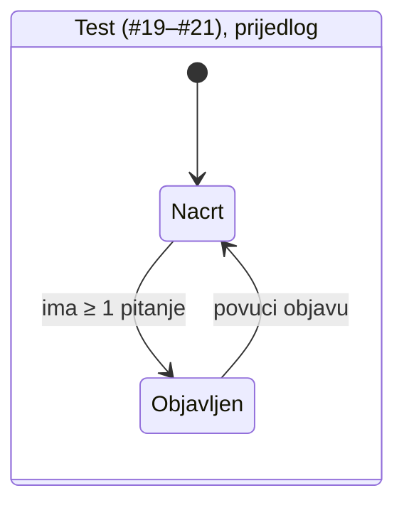

# Roadwise – mind map arhitekture

Živi dokument: pregled cijelog koda, napravljen za pripremu odbrane. Ažurira se uz svaki PR koji doda novi entitet, modul, pravilo ili ekran (vidi [§ 9 Dnevnik izmjena](#9-dnevnik-izmjena)).

> Na odbrani nema projekta ni interneta. Za svaki čvor ove mape treba znati reći: **šta je, gdje je i zašto je tako urađeno.**

Sadržaj
1. [Mind map cijelog sistema](#1-mind-map-cijelog-sistema)
2. [Slojevi i pravilo zavisnosti](#2-slojevi-i-pravilo-zavisnosti)
3. [Put jednog zahtjeva od klika do baze](#3-put-jednog-zahtjeva-od-klika-do-baze)
4. [Backend po slojevima](#4-backend-po-slojevima)
5. [Frontend](#5-frontend)
6. [Sigurnost: prijava, tokeni, uloge](#6-sigurnost-prijava-tokeni-uloge)
7. [Ključne odluke i „zašto”](#7-ključne-odluke-i-zašto)
8. [Roadwise: naš kod](#8-roadwise-naš-kod)
9. [Dnevnik izmjena](#9-dnevnik-izmjena)

---

## 1. Mind map cijelog sistema



## 2. Slojevi i pravilo zavisnosti

Clean Architecture: **zavisnosti idu samo prema unutra**. Domain ne zna ni za koga, a Application zna samo za Domain i Shared. Infrastructure implementira interfejse koje Application definiše.



| Projekat | Smije zavisiti od | Šta sadrži |
|---|---|---|
| `Roadwise.Domain` | ništa | Entiteti, enumi, `Constraints` |
| `Roadwise.Shared` | ništa (samo Hosting.Abstractions) | `JwtOptions` i ostale Options klase, `PolicyNames`, `ErrorDto`, imena okruženja |
| `Roadwise.Application` | Domain, Shared | Komande, upiti, handleri, validatori, interfejsi (`IAppDbContext`…), izuzeci, paging |
| `Roadwise.Infrastructure` | Application, Domain, Shared | `DatabaseContext`, EF konfiguracije, migracije, seederi, implementacije interfejsa |
| `Roadwise.API` | Application, Infrastructure, Shared | `Program.cs`, kontroleri, JWT autentifikacija, Swagger, CORS |
| `Roadwise.Tests` | API, Application, Shared | xUnit unit i integracijski testovi |

**Inverzija zavisnosti:** handler koristi `IAppDbContext`, a ne `DatabaseContext`. Interfejs je u Application ([IAppDbContext.cs](../Roadwise.Backend/Roadwise.Application/Abstractions/IAppDbContext.cs)), a implementacija u Infrastructure ([DatabaseContext.cs](../Roadwise.Backend/Roadwise.Infrastructure/Database/DatabaseContext.cs)). Veza se pravi u DI: `services.AddScoped<IAppDbContext>(sp => sp.GetRequiredService<DatabaseContext>())`.

Registracija slojeva u [Program.cs](../Roadwise.Backend/Roadwise.API/Program.cs):
```csharp
builder.Services
    .AddAPI(...)            // Roadwise.API/DependencyInjection.cs
    .AddInfrastructure(...) // Roadwise.Infrastructure/DependencyInjection.cs
    .AddApplication();      // Roadwise.Application/DependencyInjection.cs
```

## 3. Put jednog zahtjeva od klika do baze

Primjer: admin dodaje novi kurs u kursnu listu (`POST /Currencies/rates`).



| Korak | Gdje u kodu |
|---|---|
| Komponenta | [exchange-rates.component.ts](../Roadwise.Frontend/src/app/modules/admin/finance/exchange-rates/exchange-rates.component.ts) |
| API servis | [currencies-api.service.ts](../Roadwise.Frontend/src/app/api-services/currencies/currencies-api.service.ts) |
| Interceptori (redoslijed u `app-module.ts`) | [auth-interceptor.service.ts](../Roadwise.Frontend/src/app/core/interceptors/auth-interceptor.service.ts) |
| Middleware pipeline | [Program.cs](../Roadwise.Backend/Roadwise.API/Program.cs) |
| Kontroler | [CurrenciesController.cs](../Roadwise.Backend/Roadwise.API/Controllers/CurrenciesController.cs) |
| Validacija | [ValidationBehavior.cs](../Roadwise.Backend/Roadwise.Application/Common/Behaviors/ValidationBehavior.cs) + `CreateExchangeRateCommandValidator` |
| Handler | [CreateExchangeRateCommandHandler.cs](../Roadwise.Backend/Roadwise.Application/Modules/Finance/ExchangeRates/Commands/Create/CreateExchangeRateCommandHandler.cs) |
| Snimanje | [DatabaseConfiguration.cs](../Roadwise.Backend/Roadwise.Infrastructure/Database/DatabaseConfiguration.cs) |
| Greške | [RoadwiseExceptionHandler.cs](../Roadwise.Backend/Roadwise.Infrastructure/Common/RoadwiseExceptionHandler.cs) → [server-errors.ts](../Roadwise.Frontend/src/app/core/forms/server-errors.ts) |

**Redoslijed middlewarea je bitan** ([Program.cs](../Roadwise.Backend/Roadwise.API/Program.cs)):
`RequestResponseLogging → ExceptionHandler → HttpsRedirection → CORS → StaticFiles → /uploads 404 → Authentication → Authorization → Controllers`.
- Logging je najvanjskiji, pa mjeri i vrijeme exception handlera i bilježi konačni status kod.
- CORS mora biti prije autentifikacije, inače preflight `OPTIONS` zahtjev dobije 401.
- Statički fajlovi (`/uploads`) su prije autorizacije, pa su dostupni anonimno.

## 4. Backend po slojevima

### 4.1 Domain

- **[BaseEntity](../Roadwise.Backend/Roadwise.Domain/Common/BaseEntity.cs):** `Id`, `IsDeleted`, `CreatedAtUtc`, `ModifiedAtUtc`. Svi entiteti ga nasljeđuju.
- **Entiteti** su grupisani po domenu: `Identity` (korisnik, tokeni) i `Finance` (valute, kursevi). Roadwise dodaje svoje grupe.
- **`Constraints`** (ugniježđena klasa u entitetu) je jedini izvor istine za ograničenja poput maksimalne dužine. Koriste ga i validator i EF konfiguracija, pa se ne mogu razići.
- **Kolekcije** na entitetu imaju `private set` (npr. `RoadwiseUserEntity.RefreshTokens`). Veza se mijenja preko FK na djetetu (`RefreshTokenEntity.UserId`), a ne zamjenom cijele liste.
- **Statusi su enumi.** Starter ih više nema (bili su uz narudžbe); naši će biti npr. status termina i status testa (§ 8.6).
- **Uloge** su bool polja na korisniku: `RoadwiseUserEntity.IsAdmin / IsManager / IsEmployee`. Polje `TokenVersion` služi za opoziv svih tokena.

### 4.2 Application (CQRS)

Svaka funkcionalnost je folder u `Modules/<Oblast>/<Entitet>/Commands|Queries/<Akcija>/`:

```
Commands/Create/
  CreateXCommand.cs           → IRequest<int>, ulazni podaci
  CreateXCommandValidator.cs  → AbstractValidator, samo format ulaza
  CreateXCommandHandler.cs    → IRequestHandler, pravila + snimanje
Queries/List/
  ListXQuery.cs               → BasePagedQuery<ListXQueryDto>, filteri
  ListXQueryDto.cs            → ono što API vraća (nikad entitet)
  ListXQueryHandler.cs        → AsNoTracking + Select u DTO + PageResult
```

- **Command** mijenja stanje i vraća samo `id` ili ništa. **Query** samo čita i vraća DTO.
- **MediatR:** kontroler zna samo za `ISender`, a `sender.Send(command)` pronalazi handler. Kontroleri su zato tanki.
- **[ValidationBehavior](../Roadwise.Backend/Roadwise.Application/Common/Behaviors/ValidationBehavior.cs)** je pipeline behavior: prije svakog handlera pokreće sve validatore i baca `ValidationException`.
- **Pravilo validator ili handler** (piše u komentaru ValidationBehaviora):
  - *Validator* provjerava samo zahtjev: obavezna polja, dužine, format, odnos polja. **Nikad ne čita bazu.**
  - *Handler* provjerava pravila koja zavise od podataka u bazi: ne postoji → 404, duplikat ili konflikt → 409.
  - *Unique indeks* u bazi je zadnja linija odbrane od dva istovremena zahtjeva, jer `DbUpdateException` vraća 409.
- **Izuzeci i status kodovi** ([RoadwiseExceptionHandler](../Roadwise.Backend/Roadwise.Infrastructure/Common/RoadwiseExceptionHandler.cs)):

| Izuzetak | Status | `ErrorDto.code` |
|---|---|---|
| `ValidationException` | 400 | `validation.error` (+ `errors[]` po polju) |
| `RoadwiseUnauthorizedException` | 401 | `auth.unauthorized` |
| `RoadwiseForbiddenException` | 403 | `auth.forbidden` |
| `RoadwiseNotFoundException` | 404 | `entity.error` |
| `RoadwiseConflictException`, `RoadwiseBusinessRuleException` | 409 | `entity.error` |
| `DbUpdateException` | 409 | `database.error` (bez SQL detalja) |
| sve ostalo | 500 | `internal.error` (stack trace samo u Development) |

- **Paging** ([BasePagedQuery](../Roadwise.Backend/Roadwise.Application/Common/BasePagedQuery.cs), [PageRequest](../Roadwise.Backend/Roadwise.Application/Common/PageRequest.cs), [PageResult](../Roadwise.Backend/Roadwise.Application/Common/PageResult.cs)):
  - Query string ima oblik `?paging.page=2&paging.pageSize=10`.
  - Vrijednosti van opsega se ispravljaju umjesto odbijaju: page najmanje 1, pageSize do 1000.
  - Sortiranje je uvijek stabilno: `OrderBy(Name).ThenBy(Id)`. Bez toga paging može preskočiti ili ponoviti red.
- **Apstrakcije** su ono što Application traži od vanjskog svijeta: `IAppDbContext`, `IAppCurrentUser`, `IJwtTokenService`, `ICurrencyConverter`, `IFileStorage`, `IEmailSender`, `IExchangeRateProvider`, `ICacheService`.
- **Primjeri poslovnih pravila koja su ostala** (uzor za naše flowove):
  - [CreateExchangeRateCommandHandler](../Roadwise.Backend/Roadwise.Application/Modules/Finance/ExchangeRates/Commands/Create/CreateExchangeRateCommandHandler.cs): nepoznata valuta → 404, kurs za baznu valutu → 409 (`RoadwiseBusinessRuleException`), duplikat za isti trenutak → 409 (uz unique indeks kao zadnju odbranu).
  - [RefreshTokenCommandHandler](../Roadwise.Backend/Roadwise.Application/Modules/Auth/Commands/Refresh/RefreshTokenCommandHandler.cs): stanje tokena (aktivan, opozvan, istekao) i pravilo „ponovna upotreba = krađa”, s `TimeProvider` umjesto `DateTime.UtcNow`.
  - [CurrencyConverter](../Roadwise.Backend/Roadwise.Infrastructure/Common/CurrencyConverter.cs): kurs važeći na zadani datum i zaokruživanje `Math.Round(…, AwayFromZero)` (bitno za uplate, #8).
  - Primjeri iz startera koji su obrisani (prelazi statusa narudžbe, vlasništvo podataka „ko nije admin vidi samo svoje”, zabrana brisanja roditelja s djecom) su u repozitoriju predmeta `adil-fit-ba/rs1-2026-27`, folder `starter`.

### 4.3 Infrastructure

- **[DatabaseContext](../Roadwise.Backend/Roadwise.Infrastructure/Database/DatabaseContext.cs) + [DatabaseConfiguration](../Roadwise.Backend/Roadwise.Infrastructure/Database/DatabaseConfiguration.cs)** (ista `partial` klasa):
  - `SaveChangesAsync` prvo zove `ApplyAuditAndSoftDelete()`:
    - `Added`: postavi `CreatedAtUtc`.
    - `Modified`: postavi `ModifiedAtUtc`.
    - `Deleted`: entitet se ne briše, nego dobije `IsDeleted = true` (*soft delete*).
  - **Globalni query filter** `IsDeleted == false` je na svim `BaseEntity` tipovima, pa obrisani zapisi ne izlaze ni u jednom upitu.
  - **Konvencije:**
    - Svi `decimal` su `(18,2)`.
    - Svi `DateTime` su UTC: konverter pri čitanju postavi `DateTimeKind.Utc`.
  - `ApplyConfigurationsFromAssembly` učitava sve `IEntityTypeConfiguration<T>` iz `Database/Configurations/`.
- **Fluent API konfiguracije** (`Configurations/<Oblast>/XConfiguration.cs`): tabela, obavezna polja, dužine (iz `Constraints`), indeksi.
  - Unique indeks uz soft delete mora imati filter, npr. u `CurrencyConfiguration`: `.HasIndex(x => x.Code).IsUnique().HasFilter("[IsDeleted] = 0")`. Bez filtera ne bi se mogao ponovo kreirati zapis s vrijednošću obrisanog.
- **Migracije:** u `Migrations/` (jedna nova `Init` za Roadwise). Primjenjuju se same pri startu (`MigrateAsync` u [DatabaseInitializer](../Roadwise.Backend/Roadwise.Infrastructure/DatabaseInitializer.cs)).
- **Seederi:**
  - [StaticDataSeeder](../Roadwise.Backend/Roadwise.Infrastructure/Database/Seeders/StaticDataSeeder.cs): referentni podaci kroz `HasData`, dio migracije (valute BAM, EUR, USD).
  - [DynamicDataSeeder](../Roadwise.Backend/Roadwise.Infrastructure/Database/Seeders/DynamicDataSeeder.cs): demo korisnici i približni kursevi, samo u Development i Testing.
- **Servisi:**
  - `JwtTokenService`: izdaje i potpisuje JWT, generiše refresh token.
  - `AppCurrentUser`: čita claimove iz `HttpContext`.
  - `CurrencyConverter`: kurs važeći na datum, zaokruživanje.
  - `LocalFileStorage`: upload u `wwwroot/uploads`.
  - `SmtpEmailSender` / `LoggingEmailSender`: u Dev i Testing email ide u log.
- **Okruženja i baza:**
  - `IntegrationTests` koristi in-memory bazu, a ostala okruženja SQL Server.

### 4.4 API

- **Kontroleri** su tanki:
  - Route `[Route("[controller]")]`, auth `[Route("api/auth")]`.
  - Svaka akcija samo pozove `sender.Send(...)`.
  - `CancellationToken ct` se prosljeđuje do EF-a. Ako korisnik prekine zahtjev, prekida se i upit.
- **Konvencije odgovora:**
  - Create vraća `201 Created` + `{ id }` (`CreatedAtAction`).
  - Akcija bez povratne vrijednosti vraća `204` ([EmptyResultToNoContentFilter](../Roadwise.Backend/Roadwise.API/Filters/EmptyResultToNoContentFilter.cs)).
  - Greške modela vraćaju isti `ErrorDto` kao FluentValidation.
- **Options pattern:**
  - Konfiguracija se binduje u tipiziranu klasu, npr. `JwtOptions`, sa `.ValidateDataAnnotations().ValidateOnStart()`.
  - Pogrešna konfiguracija ruši aplikaciju pri startu, a ne pri prvom zahtjevu.
- **Zaštita od pogrešnih tajni:**
  - `EnsureJwtKeyIsAllowed` ne dozvoljava javni `DEV_ONLY…` ključ van Developmenta.
  - Isto važi za `TESTING_ONLY_…` van Testinga.

### 4.5 Tests

- **Unit testovi** (`*/UnitTests`): logika bez HTTP-a, npr. konverter valuta i guard za JWT ključ. `TimeProvider` je zamjenjiv (`Microsoft.Extensions.TimeProvider.Testing`), pa se vrijeme može „namjestiti”.
- **Integracijski testovi** (`*/IntegrationTests`): `CustomWebApplicationFactory` pokreće cijeli API u memoriji s in-memory bazom i šalje prave HTTP zahtjeve.
- Upute traže **najmanje 2 vlastita unit testa**. Testovi iz startera se ne broje.

## 5. Frontend



- **[app-module.ts](../Roadwise.Frontend/src/app/app-module.ts):**
  - Interceptori idu ovim redom: `loadingBar → auth → errorLogging`. Odgovor se vraća obrnutim redom.
  - Lokalizacija `bs-BA` (`1.234,56 KM`, datum `19.10.2026`) i zadana valuta `BAM`.
- **[app-routing-module.ts](../Roadwise.Frontend/src/app/app-routing-module.ts):** svaka zona je lazy modul (`loadChildren`). Kod modula se učitava tek kad se ode na tu rutu.
- **[my-auth-guard.ts](../Roadwise.Frontend/src/app/core/guards/my-auth-guard.ts):**
  - Pravila se zadaju u ruti: `myAuthData({ requireAuth, requireAdmin })`.
  - Neprijavljen korisnik ide na `/auth/login?returnUrl=…`, a pogrešna uloga na svoju početnu rutu.
  - **Guard štiti samo UI. Pravu zaštitu radi backend.**
- **[auth-interceptor.service.ts](../Roadwise.Frontend/src/app/core/interceptors/auth-interceptor.service.ts):**
  - Dodaje `Bearer` token **samo** za zahtjeve na `environment.apiUrl`.
  - Na 401 radi jedan zajednički refresh (*single-flight*) i ponavlja zahtjev jednom.
  - Ako refresh ne uspije: odjava i preusmjeravanje na login.
- **Auth servisi** (`core/services/auth`):
  - Tokeni se čuvaju u `localStorage` (`AuthStorageService`).
  - `AuthFacadeService` dekodira JWT (`jwt-decode`) i drži trenutnog korisnika kao **signal**.
- **Base klase** (`core/components/base-classes`):
  - `BaseListPagedComponent<TItem, TRequest>`: `request`, `goToPage`, `changePageSize`, `handlePageResult`.
  - `BaseFormComponent`: `loadData` / `save`, add i edit režim.
- **api-services:**
  - Po jedan `*-api.service.ts` (HTTP pozivi) i `*-api.model.ts` (TypeScript tipovi) za svaki kontroler.
  - Tipovi u modelu 1:1 odgovaraju C# DTO-ima.
- **Greške u formi:** `applyServerErrors(form, err)` iz [server-errors.ts](../Roadwise.Frontend/src/app/core/forms/server-errors.ts) ispisuje greške s backenda ispod odgovarajućeg polja.
- **shared:**
  - Material moduli i `fit-*` komponente (dijalog za potvrdu, paginator, prikaz greške polja, skeleton, loading bar).
  - Pipe-ovi `money` i `api-url`, servis `DialogHelperService`.
- **Prevodi:** [public/i18n/bs.json](../Roadwise.Frontend/public/i18n/bs.json) i `en.json` (ngx-translate).
- **Konfiguracija:** `environment.development.ts` i `environment.testing.ts` zamjenjuju `environment.ts` kroz `fileReplacements`. U kodu se uvijek importuje `environments/environment`.

## 6. Sigurnost: prijava, tokeni, uloge



| Pojam | Kako radi | Gdje |
|---|---|---|
| Lozinka | Čuva se samo hash (`PasswordHasher<T>`) | [LoginCommandHandler](../Roadwise.Backend/Roadwise.Application/Modules/Auth/Commands/Login/LoginCommandHandler.cs) |
| Ista poruka za svaku grešku logina | Ne otkriva koji emailovi postoje (*user enumeration*) | isto |
| Access token | JWT, 15 min, claimovi `sub`, `email` (standardni JWT claim koji čita frontend), `is_admin`, `is_manager`, `is_employee`, `ver` | [JwtTokenService](../Roadwise.Backend/Roadwise.Infrastructure/Common/JwtTokenService.cs) |
| Refresh token | Nasumičan, 14 dana, u bazi samo SHA-256 hash | `UserSessionExtensions.StartSession` |
| Rotacija | Svaki refresh opoziva stari token i izdaje novi par | [RefreshTokenCommandHandler](../Roadwise.Backend/Roadwise.Application/Modules/Auth/Commands/Refresh/RefreshTokenCommandHandler.cs) |
| Detekcija krađe | Ako se vrati već opozvan token: opoziv svih sesija i `TokenVersion++` | isto |
| `TokenVersion` / `ver` | Provjerava se na svakom zahtjevu, pa promjena lozinke ruši sve stare access tokene | `ValidateUserAndTokenVersionAsync` u [API DI](../Roadwise.Backend/Roadwise.API/DependencyInjection.cs) |
| Fallback policy | **Svaki endpoint traži prijavu**, osim onih sa `[AllowAnonymous]` | isto |
| Policy `Admin` | `[Authorize(Policy = PolicyNames.Admin)]` traži claim `is_admin = "true"`: bez tokena 401, pogrešna uloga 403 | isto |
| Defense in depth | Handler ponovo provjeri `currentUser.IsAdmin` iako endpoint već ima policy | obrazac za naše handlere (primjer je bio u obrisanom katalogu) |
| Vlasništvo podataka | Upit filtrira po `currentUser.UserId`, npr. kandidat vidi samo svoje uplate i termine | naši upiti (#9, #11, #16, #25) |

## 7. Ključne odluke i „zašto”

Kratki odgovori za tehnički intervju na odbrani.

| Pitanje | Odgovor |
|---|---|
| Zašto Clean Architecture? | Poslovna logika (Application, Domain) ne zavisi od EF-a, HTTP-a ni emaila. Infrastruktura se može zamijeniti (npr. SQL Server ili in-memory u testovima) bez mijenjanja handlera. |
| Zašto CQRS + MediatR? | Svaka akcija je jedna mala klasa s jednom odgovornošću. Čitanje je optimizovano (`AsNoTracking` + `Select` u DTO), a pisanje ima validaciju i pravila. Kontroleri ostaju tanki, a cross-cutting logika (validacija) ide u pipeline behavior. |
| Zašto DTO, a ne entitet? | API ne otkriva interna polja (`PasswordHash`, `IsDeleted`). Ugovor s frontendom se ne lomi kad se promijeni baza, a nema ni ciklusa u JSON-u ni učitavanja cijelih grafova. |
| Zašto je validacija i na frontendu i na backendu? | Frontend je za korisnika (brza poruka), backend za sigurnost (frontend se uvijek može zaobići, npr. Postmanom). |
| Zašto validator ne čita bazu? | Status kod zadržava značenje: 400 znači loš zahtjev, a 404 i 409 sukob s trenutnim podacima. Zapis se čita jednom, u handleru, a validatori se lako testiraju. |
| Zašto soft delete? | Historija i FK veze ostaju (npr. održani časovi kandidata čiji je paket obrisan). Mana je to što FK ne štiti od brisanja roditelja i unique indeks mora imati filter `[IsDeleted] = 0`. |
| Gdje je transakcija? | Jedan `SaveChangesAsync` je jedna transakcija: sve izmjene iz handlera prolaze ili ništa. Zato handler mijenja više entiteta i zove `SaveChangesAsync` **jednom**. |
| Zašto `CancellationToken`? | Ako klijent prekine zahtjev, prekida se i upit u bazi. Ne troše se resursi na odgovor koji niko ne čeka. |
| Zašto `TimeProvider` umjesto `DateTime.UtcNow`? | U testu se vrijeme može namjestiti, npr. „sutra u 10:00”. Bitno je za pravila s rokovima, kao što je naš rok otkazivanja. |
| Zašto UTC u bazi? | Nema zabune s vremenskim zonama i ljetnim računanjem vremena. Prikaz u lokalnom vremenu radi frontend. |
| Zašto stabilno sortiranje uz paging? | Ako dva reda imaju isti `Name`, baza ih smije vratiti različitim redom na dvije stranice, pa bi se red preskočio ili ponovio. `ThenBy(Id)` to sprečava. |
| Kako se mijenja konfiguracija po okruženju? | `appsettings.json` važi uvijek, a `appsettings.{Env}.json` ga dopunjava. Produkcijske tajne dolaze iz environment varijabli (`Jwt__Key`), nikad iz repozitorija. |
| Kako se dodaje nova kolona? | Entitet + `Constraints` → EF konfiguracija → `dotnet ef migrations add X` → DTO / komanda / validator → `*-api.model.ts` → forma i template. |
| Kako se dodaje nova uloga? | Polje na korisniku → claim u `JwtTokenService` → policy u `AddAuthorization` → svojstvo u `IAppCurrentUser` → guard i `myAuthData` na frontendu. |

## 8. Roadwise: naš kod

> Ovaj dio se puni kako implementiramo issuee. Uz svaki PR koji dodaje entitet, modul, pravilo ili ekran ažurira se odgovarajuća tabela i [§ 9](#9-dnevnik-izmjena).

### 8.1 Šta iz startera ostaje, a šta je obrisano (#31)

| Dio startera | Odluka | Razlog |
|---|---|---|
| Auth (login, refresh, register, reset, profil) | ostaje | Osnova za uloge instruktor i kandidat (#1) |
| Uloge admin / manager / employee | ostaje za sada | Zamjenjuje ih #1 |
| Valute i kursna lista | ostaje | Uplate u više valuta (#8, tačka 10 uputa) |
| Upload fajlova (`IFileStorage`) | ostaje | Slike pitanja (#20) i dokumenti (#27) |
| Email, keš (`ICacheService`) | ostaje | Generička infrastruktura |
| Katalog, proizvodi, kategorije, promocije, favoriti | obrisano | Web shop, ne treba Roadwiseu |
| Narudžbe, korpa, checkout, pretraga proizvoda | obrisano | Web shop |
| `ICatalogCacheVersionService` | obrisano | Vezan za katalog |
| Ime Market | promijenjeno u Roadwise | Projekti, namespaceovi, klase (`Roadwise*Exception`, `RoadwiseUserEntity`), baza `Roadwise`, nalozi `@roadwise.local` |

### 8.2 Uloge

| Uloga | Backend | Frontend zona | Issue |
|---|---|---|---|
| Instruktor | *TBD* | *TBD* | #1 |
| Kandidat | *TBD* | *TBD* | #1 |

### 8.3 Entiteti

| Entitet | Flow | Ključna polja / FK | Pravila | Issue |
|---|---|---|---|---|
| *npr. DrivingLicenseCategoryEntity* | 1 | | | #5 |

### 8.4 Moduli (Application) i endpointi

| Modul | Komande | Upiti | Kontroler / rute | Issue |
|---|---|---|---|---|
| | | | | |

### 8.5 Poslovna pravila (najvažnije za odbranu)

| Pravilo | Gdje se provjerava | Izuzetak / status | Unit test | Issue |
|---|---|---|---|---|
| Kandidat otkazuje najkasnije X sati prije termina; X je u konfiguraciji | *handler* | `RoadwiseBusinessRuleException` / 409 | *da* | #13 |
| Prijava za ispit tek nakon minimalnog broja časova iz paketa | *handler* | 409 | *da* | #17 |
| Termini istog instruktora se ne preklapaju | *handler* | 409 | | #10 |
| Uplata čuva valutu, iznos i primijenjeni kurs | *handler* | | | #8 |
| Test se može objaviti samo ako ima bar jedno pitanje | *handler* | 409 | | #21 |
| Prolaz = procenat bodova ≥ prag prolaznosti | *handler / servis* | | *da* | #24 |

### 8.6 Statusi (state machine)





### 8.7 Frontend ekrani

| Ruta | Komponenta | Uloga | Issue |
|---|---|---|---|
| | | | |

### 8.8 Naši unit testovi

| Test | Šta provjerava | Issue |
|---|---|---|
| | | |

## 9. Dnevnik izmjena

| Datum | PR / issue | Šta je dodano u mapu |
|---|---|---|
| 17. 11. 2026. | – | Početna mapa arhitekture startera i prazan okvir za Roadwise |
| 19. 11. 2026. | #31 | Clean slate: Market → Roadwise, uklonjen web shop, nova `Init` migracija; primjeri u § 3 i § 4 prebačeni na kursnu listu |
